<div align="center">
  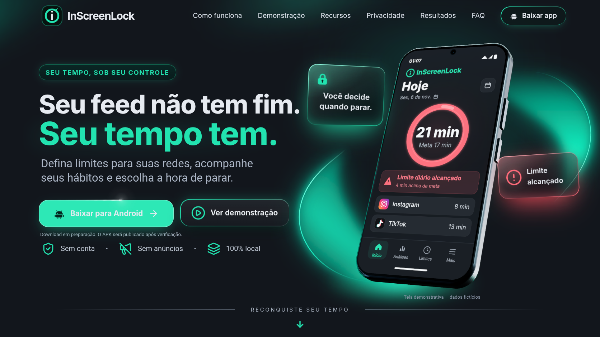
</div>

<h1 align="center">InScreenLock</h1>

<p align="center"><strong>Mais intenção no seu tempo de tela.</strong><br>Um projeto Android open source para definir limites de uso com transparência, privacidade local e controle nas mãos de quem usa.</p>

<p align="center">
  
  
  
  
  
</p>

<p align="center"><strong><a href="https://erickk-silva.github.io/InScreenLock/">Site</a></strong> · <strong><a href="https://github.com/erickk-silva/InScreenLock/releases/download/v1.0.0/InScreenLock-1.0.0.apk">Baixar APK</a></strong></p>

## Por que

É fácil abrir uma rede social por alguns minutos e permanecer nela por mais tempo do que se pretendia. O InScreenLock ajuda a transformar essa intenção em um limite diário combinado para Instagram e TikTok, com uma resposta escolhida pela própria pessoa.

O contador mede tempo de primeiro plano nos aplicativos como um todo. Inclui mensagens, perfil e outras áreas; não indica que Reels ou vídeos foram assistidos. O monitoramento começa desativado e só é habilitado após explicação e consentimento explícito.

## Recursos

- Um limite diário compartilhado entre Instagram e TikTok, ajustável nas configurações.
- Ao atingir o limite, escolha entre aviso discreto ou bloqueio voluntário com PIN local ou credencial segura do aparelho.
- A autenticação libera o uso por uma janela de até 15 minutos.
- Painel do uso de hoje por aplicativo e análise dos últimos sete dias, consultada sob demanda a partir dos dados fornecidos pelo Android.
- Onboarding explica o funcionamento e as permissões antes de pedir a ativação.
- Sem conta, conexão com a internet ou anúncios.

## Privacidade

O InScreenLock não declara a permissão `INTERNET` e não envia dados para servidores. O monitoramento depende de permissões especiais do Android, concedidas manualmente nas configurações do sistema.

| Acesso | Uso no aplicativo |
|---|---|
| Acesso de uso | Consultar tempos de primeiro plano para calcular o limite e mostrar os painéis. A análise semanal é montada sob demanda e mantida em memória. |
| Acessibilidade | Observar eventos de mudança de janela e ler apenas o nome do pacote para reconhecer Instagram e TikTok. Não lê texto, árvore visual, mensagens ou conteúdo da tela. |
| Sobreposição de acessibilidade | Apresentar aviso ou pausa sobre o app acompanhado, após ativação expressa pela pessoa nas configurações do Android. |

Preferências e dados necessários ao funcionamento do PIN ficam no aparelho. O PIN em texto não é armazenado: o app mantém uma derivação com salt. Nada sai do dispositivo.

## Galeria do app

As telas marcadas como demonstração usam dados fictícios. Onboarding e Mais/privacidade são capturas do fluxo real; as demais imagens demonstrativas representam estados da interface, não atividade de uma pessoa.

<table>
  <tr>
    <td align="center">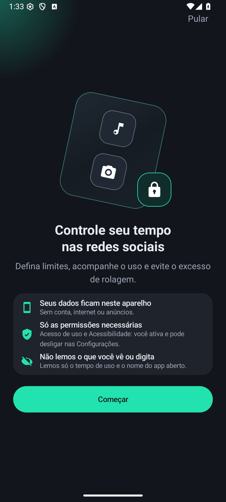<br><strong>Onboarding</strong><br><sub>Fluxo real · captura estática</sub></td>
    <td align="center">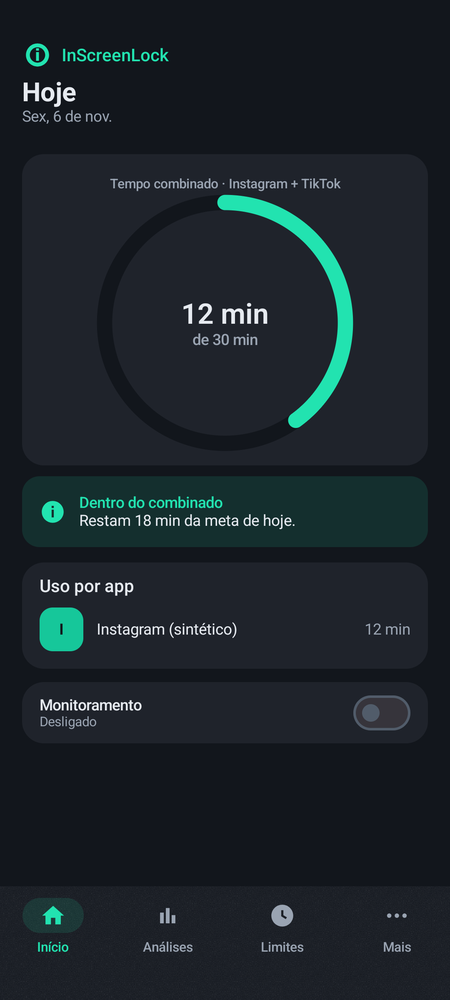<br><strong>Início</strong><br><sub>Demonstração · dados fictícios</sub></td>
    <td align="center">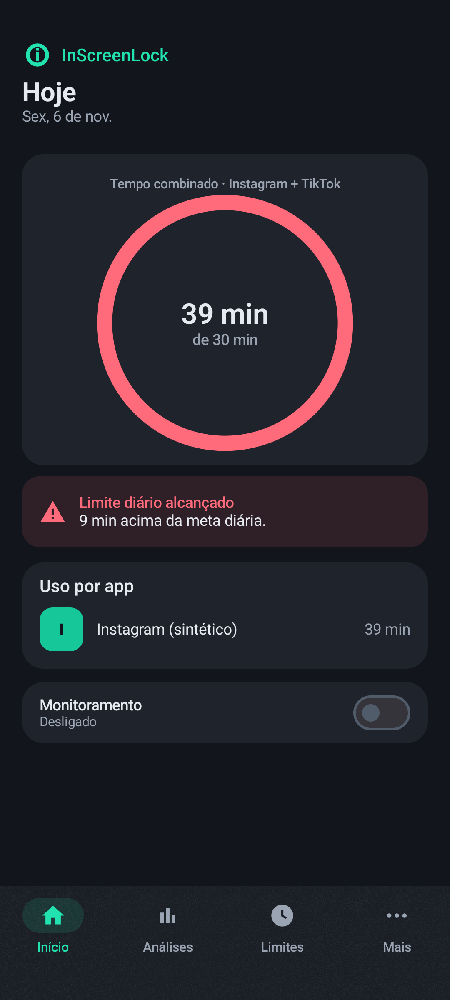<br><strong>Limite atingido</strong><br><sub>Demonstração · dados fictícios</sub></td>
    <td align="center">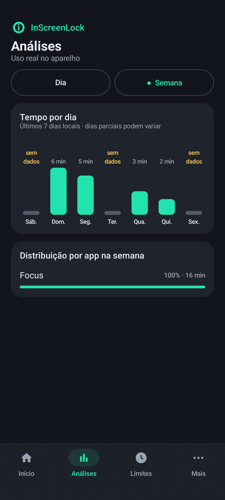<br><strong>Análises · semana</strong><br><sub>Demonstração · dados fictícios</sub></td>
  </tr>
  <tr>
    <td align="center">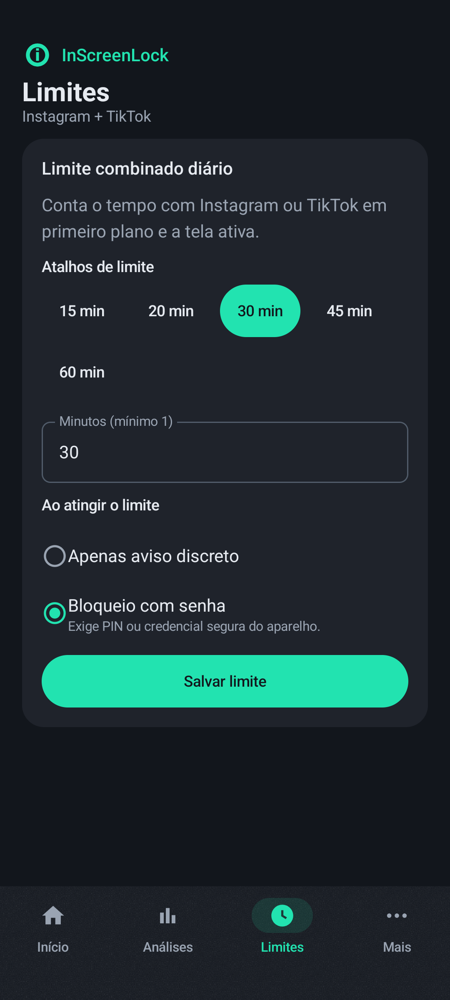<br><strong>Limites</strong><br><sub>Demonstração · dados fictícios</sub></td>
    <td align="center">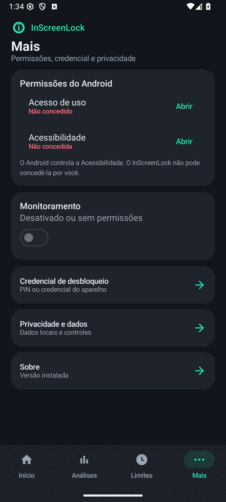<br><strong>Mais · privacidade</strong><br><sub>Fluxo real · captura estática</sub></td>
    <td align="center">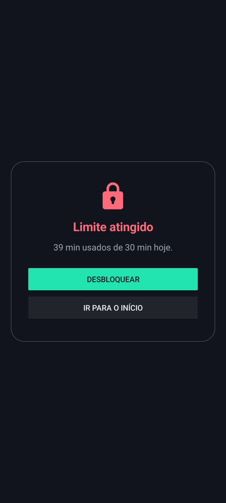<br><strong>Pausa</strong><br><sub>Demonstração · dados fictícios</sub></td>
  </tr>
</table>

## A landing page

O site apresenta a proposta, os recursos, o fluxo e as decisões de privacidade do projeto. Foi desenvolvido separadamente do app com Next.js 16, React 19, Tailwind CSS 4, React Three Fiber e React Bits.

<p align="center">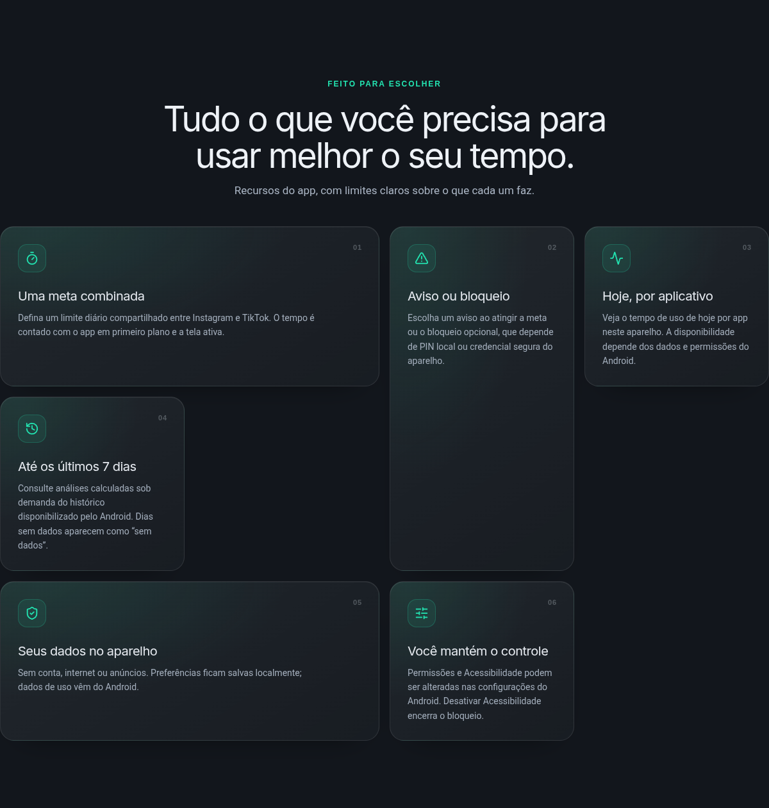</p>
<p align="center">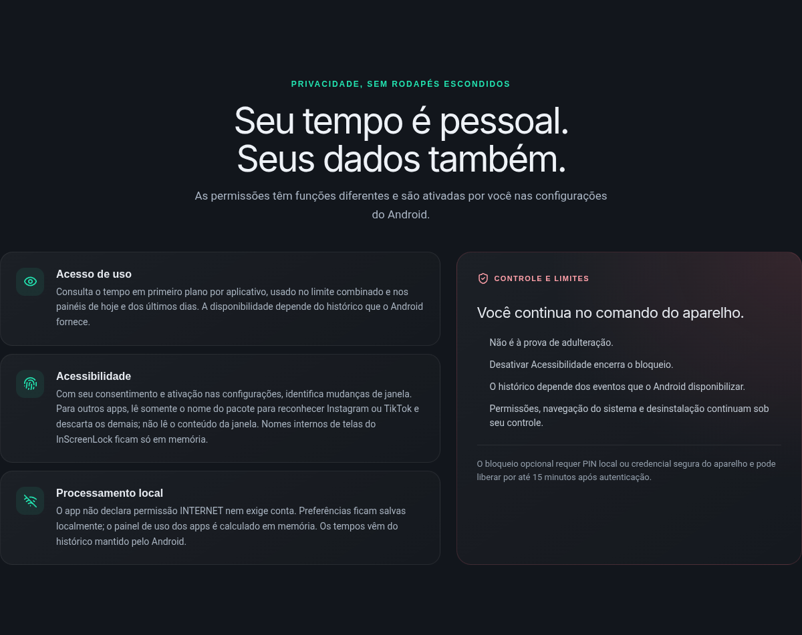</p>

A licença dos componentes React Bits usados na landing inclui MIT + Commons Clause; consulte [landing/NOTICE-REACT-BITS.md](landing/NOTICE-REACT-BITS.md).

## Instalação do APK

A versão 1.0.0 é distribuída como APK assinado, fora da Play Store, e requer Android 9 ou superior.

1. Baixe o [InScreenLock 1.0.0](https://github.com/erickk-silva/InScreenLock/releases/download/v1.0.0/InScreenLock-1.0.0.apk).
2. Verifique o SHA-256 antes de instalar. No Linux ou macOS:

   ```sh
   sha256sum InScreenLock-1.0.0.apk
   ```

   No Windows, no Prompt de Comando:

   ```bat
   certutil -hashfile InScreenLock-1.0.0.apk SHA256
   ```

   O resultado esperado é `cd2c657e18b51fe67807f2f8d548ffdfbffa897b665e58b85317ea6d75ad1071`.

3. Confira o certificado de assinatura: `77:DC:00:AA:87:3C:C7:97:F5:40:CE:D6:20:73:FD:70:CD:AA:0B:5B:A0:7E:22:BA:F8:B8:96:39:26:DB:6A:9E`.
4. Abra o APK no aparelho e autorize a instalação pela origem escolhida, se o Android solicitar.
5. No Android 13 ou superior, se o sistema bloquear a ativação da Acessibilidade por **Configuração restrita**, abra as informações do InScreenLock, toque no menu `⋮` e permita configurações restritas. Os nomes e caminhos variam conforme a versão e o fabricante.
6. Abra o app, leia a explicação e habilite o monitoramento. Conceda **Acesso de uso** e ative o serviço em **Acessibilidade** nas configurações do Android.
7. Escolha o limite combinado e o comportamento ao alcançá-lo. Para usar o bloqueio, configure um PIN no app ou uma credencial de tela segura no dispositivo.

## Arquitetura

O app Android está organizado em um único módulo Kotlin. A acessibilidade reconhece mudanças de janela; o controller coordena sessões; os dados de uso confirmam as transições antes de exibir ou remover o overlay.

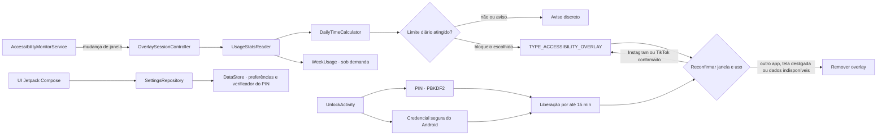

A reconfirmação evita manter o bloqueio em uma janela ambígua ou quando não há dados suficientes. O PIN é verificado localmente com PBKDF2; uma credencial segura pode ser validada pelo Android.

### Estrutura do repositório

```text
.
├── app/                 # aplicativo Android e testes
├── landing/             # site do projeto
├── docs/
│   ├── adr/             # decisões de arquitetura
│   ├── images/          # imagens da documentação
│   └── spec/            # especificação congelada
├── .github/             # modelos de issue e pull request
├── CONTRIBUTING.md
├── LICENSE
├── README.md
└── SECURITY.md
```

### Decisões de arquitetura

- [ADR-0001 — Android nativo e Harness Lite](docs/adr/ADR-0001-native-android-and-harness-lite.md): APIs nativas para um app pequeno e offline.
- [ADR-0002 — Bloqueio com credencial](docs/adr/ADR-0002-credential-lock.md): autenticação, PIN local e liberação temporária.
- [ADR-0003 — Painel de uso por app](docs/adr/ADR-0003-all-apps-usage-dashboard.md): cálculo e apresentação do uso diário.
- [ADR-0004 — Redesign e análise semanal](docs/adr/ADR-0004-redesign-and-weekly-usage.md): navegação, interface e consulta semanal sob demanda.

## Qualidade

A versão 1.0.0 inclui 94 testes unitários e 21 testes instrumentados. Também passou por E2E em aparelho físico Samsung Galaxy Tab e revisões independentes. Esses resultados são referentes à versão publicada; um build isolado não comprova o comportamento em um aparelho.

A landing tem 37 cenários E2E. Na avaliação Lighthouse desktop, obteve 94 em Performance e 100 em Acessibilidade, Boas práticas e SEO.

## Desenvolvimento

### Aplicativo Android

Requer JDK 17 e Android SDK. Para compilar a variante de depuração:

```sh
./gradlew assembleDebug
```

Os testes do app são executados com:

```sh
./gradlew testDebugUnitTest
./gradlew connectedDebugAndroidTest
```

### Landing page

Requer Node.js e npm. Para desenvolvimento local:

```sh
cd landing
npm ci
npm run dev
```

Para executar os testes unitários e E2E da landing:

```sh
npm test
npm run e2e
```

Para gerar a versão de publicação no GitHub Pages:

```sh
npm run build:pages
```

## Roadmap

Itens planejados, ainda não disponíveis:

- Histórico próprio opcional, condicionado a uma decisão explícita sobre retenção e privacidade.
- Suporte a mais aplicativos, com escopo e validação próprios.
- Melhorar a performance móvel da landing page.
- Modo de estimativa de transições de vídeo somente após validação física no Instagram e no TikTok; não há promessa de identificar vídeos assistidos.
- Distribuição pela Play Store não está prevista.

## Limitações

- O limite mede o tempo total de uso em primeiro plano dos apps-alvo, não o tempo assistindo Reels ou vídeos.
- O painel semanal depende do histórico que o Android disponibiliza e pode estar incompleto ou indisponível.
- O bloqueio é voluntário. Desativar Acessibilidade encerra o bloqueio; também é possível forçar a parada ou desinstalar o app.
- O Android mantém sob controle da pessoa a navegação do sistema, as configurações e as permissões. A sobreposição pode variar conforme aparelho e versão do sistema.
- Não há versão para iOS.

## Contribuição e segurança

Leia [CONTRIBUTING.md](CONTRIBUTING.md) antes de abrir uma issue ou pull request. Para relatar uma vulnerabilidade, siga as instruções em [SECURITY.md](SECURITY.md).

## Licença

O código deste repositório é distribuído sob a [Licença MIT](LICENSE). Os componentes React Bits usados na landing têm MIT + Commons Clause, conforme [landing/NOTICE-REACT-BITS.md](landing/NOTICE-REACT-BITS.md).
